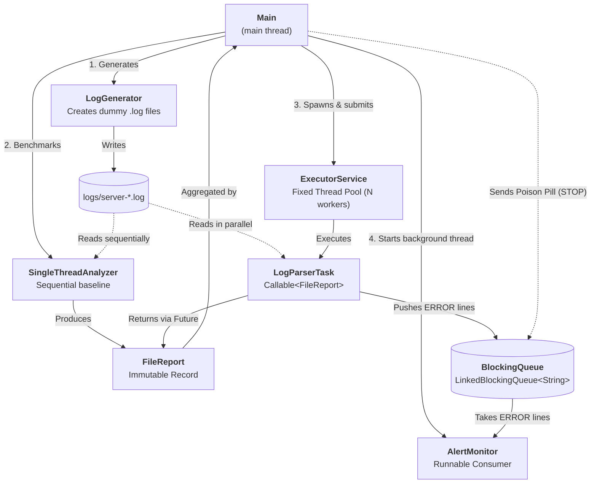

Here is a breakdown of what each of the three classes does and how they work together:

---

### 1. `FileReport.java` — The Thread-Safe Data Carrier

* **Purpose:** Holds the parsed statistics (`fileName`, `infoCount`, `warnCount`, `errorCount`) for a single log file.
* **Why it's designed this way:**
* It uses a Java `record`, which automatically makes all fields `private final` (immutable) and generates getters (`fileName()`, `infoCount()`, etc.), `equals()`, `hashCode()`, and `toString()`.
* **Multithreading significance:** In later phases, worker threads will create a `FileReport` and hand it back to the `main` thread via `Future<FileReport>`. Because `FileReport` is completely immutable, no thread can accidentally modify it while another thread reads it—eliminating race conditions without needing locks.
* `totalLines()` is a convenience method that sums up the three counters for that file.


---

### 2. `LogGenerator.java` — The Test Data Factory

* **Purpose:** Creates realistic dummy `.log` files on disk so your analyzer has a heavy, real-world workload (500,000 lines across 10 files) to process and benchmark.
* **How each part works:**
* `INFO_MESSAGES`, `WARN_MESSAGES`, `ERROR_MESSAGES`: Immutable `List.of(...)` templates used to build realistic server log lines.
* `generateLogs(directoryPath, fileCount, linesPerFile)`: Checks if the `logs/` folder exists (creating it if needed) and loops from `1` to `fileCount` to create `server-1.log` through `server-10.log`.
* `writeSingleFile(...)`: Uses `BufferedWriter` (which buffers text in memory before writing to disk in chunks, making writing 500,000 lines fast) and generates a weighted distribution of logs:
* **80% `INFO**` (`roll < 80`)
* **15% `WARN**` (`roll < 95`)
* **5% `ERROR**` (the remaining 5%)


* **`ThreadLocalRandom.current()`:** Instead of `new Random()` or `Math.random()` (which use shared synchronized seeds that slow down under multiple threads), `ThreadLocalRandom` gives each thread its own isolated random number generator—a best practice in concurrent Java.


---

### 3. `Main.java` — The Orchestrator / Entry Point

* **Purpose:** Acts as the control center of the application. Right now, it only triggers Phase 1 (`LogGenerator.generateLogs(...)`), so you can confirm your files generate properly.
* **Role going forward:** In Phases 2, 3, and 4, `Main.java` will run the single-threaded analyzer, spin up the `ExecutorService` thread pool and `AlertMonitor` consumer thread, collect all `FileReport` objects, and compare the single-threaded vs. multi-threaded execution speeds.

---

### How They Fit Together Right Now

```text
Main.java
   │
   └── calls ──> LogGenerator.java ── writes ──> logs/server-1.log ... server-10.log
                 (FileReport.java is ready for Phase 2 & 3 when we start reading those files)

```

Once you've verified that the `.log` files appear in your `logs/` folder, let me know and we will implement **`SingleThreadAnalyzer.java`** (Phase 2)!